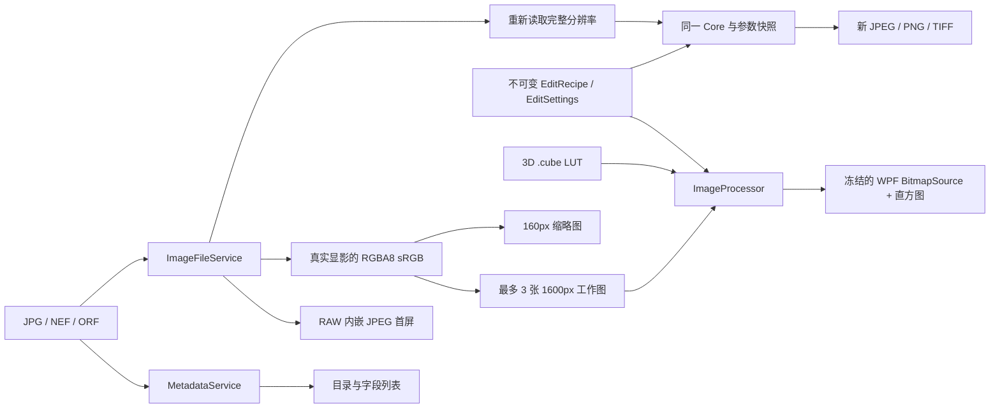

# 架构与实现边界

RawSpeed 是基于 C#、WPF 和 .NET 9 的 Windows x64 照片编辑器。当前实现将文件解码、元数据、像素处理和界面状态分开，便于测试与后续替换处理后端。性能数据与复现方式见 [testing.md](testing.md)。

## 项目职责

| 项目 | 职责 | 依赖方向 |
| --- | --- | --- |
| `RawSpeed.App` | WPF 视图、命令、照片选择、编辑历史、配方、显示缓存 | 调用 Core、Imaging、Metadata |
| `RawSpeed.Core` | RGBA 像素处理、参数校验、曲线、3D `.cube` LUT | 不依赖 WPF、文件解码或外部 NuGet 包 |
| `RawSpeed.Imaging` | JPEG / NEF / ORF 读取，RAW 内嵌预览，JPEG / PNG / TIFF 编码 | Magick.NET 与其 native 图像库 |
| `RawSpeed.Metadata` | 全目录元数据、MakerNotes、XMP 属性和解析警告 | MetadataExtractor |
| `RawSpeed.Core.Tests` | 像素数学、参数边界、取消和并发确定性 | Core |
| `RawSpeed.App.Tests` | WPF Dispatcher 上的编辑状态、配方、切图与渲染竞争 | App；不打开应用窗口或系统对话框 |
| `RawSpeed.IntegrationTests` | 用户样片从读取到导出、像素回环、原片保护、性能记录 | Core、Imaging、Metadata |

## 文件读取与显影

`ImageFileService` 仅接受 `.jpg`、`.jpeg`、`.nef`、`.orf`。它在后台调用 Magick.NET-Q16，再通过打包的 ImageMagick / LibRaw 完成 RAW 显影。RAW 路径使用相机白平衡和 sRGB 输出；JPEG 使用 ICC 转换与适用的 reduced IDCT 预览解码。EXIF 方向在输出尺寸与像素之前统一处理。

RAW 打开时可以先提取相机内嵌 JPEG，界面明确显示“相机内嵌预览”，随后以真正的 RAW 显影替换。内嵌 JPEG 的颜色、裁边和尺寸可以与 LibRaw 结果不同。它没有作为 RAW 编辑或完整尺寸导出的数据源。

`DecodedImage` 携带当前尺寸、方向处理后的原尺寸、源路径、解码模式和紧密排列的 RGBA8 像素。像素数组在语言层面可写，但处理模块将输入视为只读；`ImageProcessor.Render` 生成独立输出，测试验证输入不变。新的处理器也必须遵守该约定。

## 像素管线

当前处理顺序为：几何变换 → 显示空间颜色调整 → 3D LUT → 可分离双边降噪 → RGB 直方图。

- 几何包括 90°旋转、翻转、拉直和裁切。裁切使用方向调整后的归一化坐标；拉直通过适度放大避免空角。
- 曝光、色温偏移、色调、对比度、高光/阴影和曲线预计算为通道查找表。色相/饱和度和 LUT 尽量合并在一次像素遍历中。
- 曲线使用三个可调内部节点与固定黑白端点。`EvaluateCurve` 与实际渲染共享曲线数学，防止界面曲线和结果不一致。
- `.cube` 使用红色分量变化最快的存储顺序和三线性插值；支持独立 3D LUT，明确拒绝 1D/shaper LUT。LUT 的文件格式不保证其工作空间正确，当前按显示空间 sRGB 数值使用。
- 降噪是两遍短半径双边近似，复用数组池中的临时缓冲；它不是 AI 去噪或 DxO DeepPRIME。
- 按行并行处理，最大并行度为 `max(1, min(16, 逻辑处理器数 - 1))`。颜色与几何阶段接收取消 token。

WPF 合成可以由系统使用 GPU，但图像解码、编辑和降噪的本项目管线当前是 **CPU 后端**。

## 并发、取消与界面更新

界面状态由 WPF Dispatcher 管理。读取、LUT 加载、像素计算和位图构造通过后台任务完成；位图在返回界面前 `Freeze()`，允许安全地跨线程交付。

切换照片会取消前一次加载和预览渲染。每个异步阶段之后检查 token；旧请求不能把元数据、原图或图像结果写回新照片。连续参数变化采用约 45ms 防抖，取消过期工作，并由 `_renderGate` 限制每个 ViewModel 同时只运行一个预览渲染。

Imaging 的进程级 `NativeGate` 限制同一时刻仅一个 native 读取/编码任务，防止多张完整尺寸图像同时显影造成内存峰值。完整尺寸 CPU 渲染与预览渲染属于不同路径，仍可能短时并行；这里不是整个进程的全局任务调度器。

等待信号量与阶段间检查支持取消。**进行中的 native 解码/编码不能安全强制中断**，取消请求会在其返回后被观察并丢弃结果。MetadataExtractor 的同步读取同样只在外层任务前后检查。界面“已请求取消”不表示 native 调用已即时停止。

导出在开始时捕获源路径、配方与 LUT 快照。用户之后修改滑块或切换照片，不会改变正在进行的导出内容。

## 缓存与内存预算

工作图缓存最多保留 **3 张**显影后、长边不超过 **1600px** 的 RGBA8 图像。当前淘汰策略为插入顺序 FIFO，命中不会刷新队列，不能称为 LRU。滑块调整使用缓存，不重复读取 RAW。

照片项仅保存最长边 **160px** 的缩略图。缩略图在照片成功载入后创建，不能把 1600px 工作图直接长期挂在文件列表上。3 张工作图上限约束的是较大的已解码缓存，并非整个应用的硬内存上限：当前图像结果、WPF BGRA 副本、native 缓冲和完整尺寸导出都会额外占用内存。

一个 2400 万像素 RGBA8 缓冲约为 91.6 MiB，多份结果及 Q16 native 中间缓冲仍可能达到数百 MiB。配方/文件列表、已访问缩略图和 LUT 缓存目前随会话增长；尚未实现字节预算式 LRU、后台磁盘缓存、文件变更失效检测或大型图库索引。打开超大目录不能从“工作图最多 3 张”推导出全局恒定内存。

## 配方、历史与原片保护

`EditSettings` 与 `EditRecipe` 是不可变 record，修改参数产生新值。撤销保存参数而不保存每一步全尺寸像素；同一滑块约 550ms 内的连续操作合并，普通编辑历史限制为 80 项。

显式保存将版本为 1 的 JSON 写入原片旁的 `<原文件名>.rawspeed.json`。先写同目录临时文件，再替换边车；读取时校验版本、参数范围和大小上限。LUT 保存为文件路径，移动 LUT 后需要重新定位；边车不嵌入 LUT 数据。

导出先在目标目录编码临时文件，确认未取消后以“不覆盖”移动发布；已存在目标会报错，包括竞争期间出现的文件。JPEG 使用独立质量参数；PNG 使用无损压缩级别 2，避免把 JPEG 质量值错误映射成高成本 PNG 压缩。导出包含 sRGB 颜色声明，但目前不复制源 EXIF/IPTC/XMP。

## 精度与后续演进

Magick.NET-Q16 的内部精度不能改变当前公共接口是 **8-bit、显示空间 sRGB** 的事实。进入编辑器后已量化到 RGBA8；曝光和白平衡不能恢复此前被显影裁掉的高光。现有色温控件是冷暖偏移，不是传感器域的绝对 Kelvin 标定。TIFF 输出也是 8-bit，不能仅凭文件扩展名宣称高精度工作流。

后续高质量与 GPU 路线建议分阶段实现，每一步保留当前 CPU 路径作为测试参照：

1. 引入明确的像素格式、颜色空间和缓冲生命周期抽象；为 16-bit / float scene-linear 解码定义独立接口，避免把 `byte[]` 改名后就称为高精度。
2. 将相机白平衡、黑电平、曝光、高光恢复与色彩变换移入合适的线性处理阶段；增加相机 profile、显示 profile 与 16-bit TIFF 验证。
3. 加入按字节预算的缓存、预览分辨率分级和 ROI 渲染；用真实样片测量传输、内存和整条任务延迟。
4. 在稳定处理接口下实现 Direct3D / ComputeShader 后端，明确 CPU/GPU 像素一致性容差与设备失败回退。避免每个滑块操作重复上传整幅图，也不要把 GPU 部署成本藏在纯 shader 计时之外。
5. 如果加入 AI 降噪，独立管理模型版本、权重许可证、显存、取消与画质评测，维持传统降噪可用。

以上是演进方向，未实现的功能不应出现在当前能力声明中。
