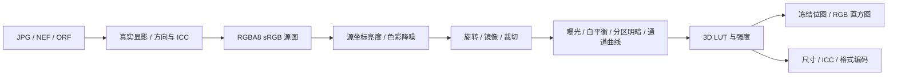

# 架构与实现边界

RawSpeed 0.2 使用 C#、WPF、.NET 9，分层保持文件解码、元数据、像素数学和界面调度独立。

| 项目 | 职责 |
| --- | --- |
| Core | 无第三方依赖的 RGBA8 处理、ToneCurve、几何映射、灰点取样、多尺度降噪、CubeLut |
| Imaging | Magick.NET/LibRaw 解码；可配置编码、ICC、尺寸、常用拍摄 EXIF 映射 |
| Metadata | MetadataExtractor 完整目录、MakerNotes、XMP 和解析警告 |
| App | WPF/MVVM、会话历史、预览调度、配方、星级、偏好、滤镜目录 |

## 像素与坐标

RAW 内嵌 JPEG 只用于首屏；真实编辑和完整尺寸导出使用 LibRaw 显影。Q16 显影后转为 RGBA8，编辑目前为 8-bit 显示域 sRGB。16-bit 输出容器不会提高原来的编辑精度。

`ToneCurve` 复制并只读暴露 2–64 个点，以结构相等支持配方/历史；使用形状保持的 PCHIP。只有首末 X 固定为 0、1，首末 Y 可动，中间点可以增删和拖动。旧三节点曲线与 Denoise 字段保留为版本 1 配方兼容接口，新界面使用自由曲线和独立降噪参数。

`ImageGeometry` 是渲染和取样共用的正反变换，像素中心左上为 (0,0)。裁切坐标归一化到旋转/镜像/自由旋转后的画布。自由旋转通过放大填满原画布避免黑角。灰点点击先反变换到未调整的源图，以区域样本估计绝对 Temperature/Tint，排除近黑、剪白和透明点。

`PhotoViewport` 在同一逻辑原图尺寸坐标中实现指针锚定缩放、平移、左右/划线对比和裁框。全分辨率加载替换缩小工作图时，缩放视野不跳变。对比原图只使用当前几何参数，无颜色/LUT/降噪；因此左右像素区域对齐。构图页渲染未裁画布及八个手柄，松开鼠标写入配方；其他页显示裁切结果。`CropInteraction` 的归一化手势计算可脱离鼠标设备测试。

## 调度与内存

WPF Dispatcher 持有状态。解码、LUT 加载、像素处理及位图构造在后台；交付前冻结 BitmapSource。连续编辑防抖约 45ms，取消旧任务，预览渲染门保证每个编辑器只有一个正在计算的预览。

加载使用取消 token 和照片版本；滤镜另有请求版本，清除、重置、撤销和切图使旧滤镜请求失效。导出捕获源路径、完整参数和 LUT 快照，随后切图或调参不会改动该导出。native 解码/编码进程级串行，其进行中的调用不能强制中止，取消会在返回后丢弃结果。

- 缩小源图：最多 3 张、最长边 1600，FIFO。
- 原尺寸源图：只保留当前照片，点击100%/D或放大到阈值时读取。
- 缩略图：按虚拟列表可见项目加载、最长边240、最多128张；容器回收换照片时重新请求。
- 降噪：只缓存当前源引用及四个降噪参数对应的一份缓冲；后续调色、构图复用。原图对比位图按源引用和几何缓存。
- 历史：最多80项不可变参数，连续同字段操作合并。会话参数和LUT缓存仍随已访问照片/滤镜数量增长，并非全进程恒定内存。

2400万像素单份RGBA8约91.6 MiB。源图、降噪缓冲、当前结果、对比结果及Q16 native临时区会叠加；尚无全局字节预算、GPU或ROI处理。

## 持久化与文件安全

配方使用原片旁的 `.rawspeed.json`，参数/大小/版本校验后原子替换。版本 2 的目录滤镜保存稳定的源 ID、SHA-256、适配版本及原始路径，不保存生成缓存路径；缓存丢失时从相同源文件重建。旧版普通 Cube 路径继续兼容，无法恢复的滤镜引用保留并提示，避免下一次保存永久丢失效果。迁移和恢复规则见 [编辑配方格式](recipe-format.md)。星级与偏好在LocalAppData中原子保存。数字和快捷键解析、冲突检查与实际操作分离，方便无窗口测试。

导出先写目标目录临时文件，再不覆盖地移动至目标。尺寸、DPI、编码、ICC和元数据由不可变ExportOptions校验。JPEG可以从原Exif提取白名单字段，RAW从标准IFD读取，清除旧方向、尺寸、缩略图及MakerNotes；GPS仅在显式选择保留时复制。

滤镜目录扫描原文件，首次使用时按原文件SHA-256和适配器版本烘焙33³ sRGB LUT到LocalAppData。缓存损坏可重建，不要求安装目录可写。来源与不支持参数保留在列表模型；资源许可/默认发布排除规则见 [lut-catalog.md](lut-catalog.md)。

后续高精度路线应先引入明确float/scene-linear像素类型和颜色空间，再推进GPU/局部区域渲染；不能把现有byte数组改名后宣称专业RAW精度。
